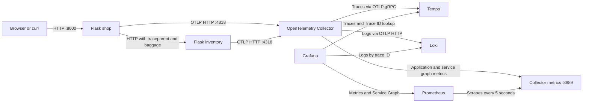

# Corner Shop | OpenTelemetry demo

Corner Shop is a local Flask storefront for learning how a request becomes a distributed trace. Check stock, complete a simulated checkout, or trigger an inventory failure. Then follow the request across the shop and inventory services in Grafana and see the W3C baggage each service received.

## Run the demo

You need Docker with Docker Compose v2 and internet access for the initial image builds and Grafana plugin download. On a fresh clone, run these commands from the project directory. If you already have a local `.env`, use it and run the startup script directly.

```sh
cp .env.example .env
./scripts/start.sh
```

The script builds and starts the stack in the background, waits for the shop and Grafana health checks, and prints their URLs. The default ports are bound to your machine's loopback interface.

| Open | What you'll find |
| --- | --- |
| [Product Stock](http://localhost:8000/) | Check inventory and see the endpoint name received downstream. |
| [Checkout](http://localhost:8000/checkout) | Try a successful checkout or simulate an inventory error. |
| [Grafana dashboard](http://localhost:3000/d/shop-executive/shop-checkout-and-baggage) | Browse checkout traces, the selected request's service journey, and inventory logs. The initial local login is `admin` / `admin`. |

Run `./scripts/stop.sh` to stop and remove the Compose containers and network. The demo uses local container storage and can start with fresh telemetry and Grafana state after container removal or recreation.

## Follow a checkout in Grafana

1. On **Checkout**, click **Try demo checkout**. The page shows `shop.endpoint = checkout` after inventory receives it. Click **Simulate checkout error** to generate a second trace. Inventory returns HTTP `503`, and the shop returns HTTP `502`.
2. Open the dashboard and choose a time range that includes the requests. Set **Transaction status** to **All** or **Failed**. **Failed** matches checkout responses with HTTP status `400` or higher. The **Trace ID** dropdown lists up to 30 matching checkout traces for that time range. Allow a few seconds for export and refresh if the request has just finished.
3. Select a **Trace ID**. The **Selected trace service journey** shows the services involved, and the **Selected trace waterfall** shows their individual spans and timing. Expand the inventory server span and look for `shop.endpoint=checkout` and `shop.demo.cohort=web`. On a failed checkout, the inventory and shop server spans show an error.
4. Choose **Logs for this span** in the waterfall to open Loki in Explore with the same trace ID. The inventory log includes `shop_endpoint=checkout` and `demo_cohort=web`. On a failed checkout, look for `Simulated inventory failure`. Expand the Loki entry and choose **Open trace in Tempo** to go back to the full trace.

The dashboard also shows checkout and inventory totals and the share of logged inventory checks with a demo cohort. Its **Baggage received downstream** panel shows matching `Inventory checked` messages. To see failure messages, use the span-to-logs link or the Loki error query below.

For the aggregate dependency graph, open **Explore → Tempo → Service Graph** and run the query after generating several requests. This view uses Prometheus metrics to show checkout and stock traffic, errors, and latency between services over the selected time range. The dashboard's service journey shows one selected trace.

## Architecture

The same Python image runs two Flask processes with separate OpenTelemetry service names. The **shop** serves the pages and public API. The **inventory** service resolves stock from an in-memory product catalog and is reachable on the Compose network.



The Collector's `servicegraph` connector pairs client and server spans and publishes dependency metrics through the existing Prometheus exporter. Grafana provisions Tempo, Loki, and Prometheus, plus an Infinity data source that queries Tempo's search API for dropdown values.

### How one request becomes a trace

With the defaults, [start.sh](start.sh) launches both Flask processes through `opentelemetry-instrument`. Flask creates incoming HTTP spans and Requests creates the outgoing HTTP span. The app adds two application spans to make its own work visible. One valid stock request or checkout produces this hierarchy:

```text
shop       GET /api/products/<int:product_id>/stock or POST /api/checkout
└─ shop.check_inventory
   └─ shop HTTP GET (Requests)
      └─ inventory GET /inventory/<int:product_id>
         └─ inventory.read_stock
```

- **Trace context** connects the outgoing request with the downstream server span. Requests injects W3C `traceparent` and Flask extracts it at inventory.
- **Baggage** carries request-scoped values. The browser supplies `demo.cohort=web`; the shop attaches `shop.endpoint=product_stock` or `shop.endpoint=checkout` to the outbound request's OpenTelemetry context. Requests injects the W3C `baggage` header and Flask extracts it downstream.
- **Recording** makes those values searchable. Application code copies the supported values onto spans as `shop.endpoint` and `shop.demo.cohort`, and includes them in inventory log messages as `shop_endpoint` and `demo_cohort`. Loki also receives the log record's OpenTelemetry trace ID as structured metadata, which Grafana uses to link logs and traces.

## API and command-line examples

| Method | Path | Purpose |
| --- | --- | --- |
| GET | `/` | Product Stock page |
| GET | `/checkout` | Checkout page |
| GET | `/health` | Shop health check |
| GET | `/api/products` | Product catalog |
| GET | `/api/products/1` | Product details |
| GET | `/api/products/1/stock` | Check inventory and return the downstream endpoint value |
| POST | `/api/checkout` | Simulate checkout or trigger the inventory failure |

```sh
# Check stock. The response includes inventory_endpoint=product_stock.
curl -fsS http://localhost:8000/api/products/1/stock

# Check out. The response includes inventory_endpoint=checkout and inventory_cohort=demo.
curl -fsS http://localhost:8000/api/checkout \
  -H 'Content-Type: application/json' \
  -H 'baggage: demo.cohort=demo' \
  -d '{"product_id":1,"quantity":2}'

# Generate a correlated error trace. Expect HTTP 502 from the shop.
curl -si http://localhost:8000/api/checkout \
  -H 'Content-Type: application/json' \
  -H 'baggage: demo.cohort=demo' \
  -d '{"product_id":1,"quantity":1,"simulate_error":true}'
```

For stock lookups in Tempo Explore, use `{ resource.service.name = "inventory" && span.shop.endpoint = "product_stock" }`. To check the other signals in Explore, try these queries.

| Data source | Query |
| --- | --- |
| Tempo | `{ resource.service.name = "inventory" && span.shop.endpoint = "checkout" && status = error }` |
| Loki | `{service_name="inventory"} \|= "Simulated inventory failure"` |
| Prometheus | `traces_service_graph_request_total{client="shop",server="inventory"}` |

## Configuration

The local `.env` is ignored by Git. [.env.example](.env.example) supplies the defaults for a fresh clone.

| Setting | Default | Purpose |
| --- | --- | --- |
| `OTEL_SDK_DISABLED` | `false` | Starts Python under the auto-instrumentation agent. Set `true` to run plain Python. |
| `OTEL_PROPAGATORS` | `tracecontext,baggage` | Enables W3C Trace Context and Baggage. Use `tracecontext` alone to keep distributed traces while disabling baggage propagation. |
| `OTEL_EXPORTER_OTLP_ENDPOINT` | `http://collector:4318` | Collector address on the Compose network. |
| `OTEL_EXPORTER_OTLP_PROTOCOL` | `http/protobuf` | OTLP transport used by Python. |
| `OTEL_TRACES_EXPORTER`, `OTEL_METRICS_EXPORTER`, `OTEL_LOGS_EXPORTER` | `otlp` | Export each signal to the Collector. |
| `OTEL_PYTHON_LOGGING_AUTO_INSTRUMENTATION_ENABLED` | `true` | Captures standard Python logging with the pinned SDK. |
| `OTEL_METRIC_EXPORT_INTERVAL` | `5000` | Python application metric export interval in milliseconds. |
| `SHOP_PORT`, `GRAFANA_PORT` | `8000`, `3000` | Published host ports. |

After changing instrumentation settings, apply them with `docker compose up -d --force-recreate shop inventory`. To compare baggage on and off, leave the SDK enabled and change only `OTEL_PROPAGATORS`. With `tracecontext` alone, both services still share the trace, but inventory reports a null `inventory_endpoint`. Apply host port changes with `./scripts/start.sh` and use the printed URLs.

## Developer reference

| File | What it controls |
| --- | --- |
| [app.py](app.py) | Flask routes, the inventory HTTP call, baggage handling, named application spans, and error simulation. |
| [shop.html](shop.html) | Product Stock and Checkout pages and their browser requests. |
| [compose.yaml](compose.yaml) | Local services, network, mounts, and published ports. |
| [config/collector.yaml](config/collector.yaml) | OTLP pipelines, service graph connector, and Prometheus exporter. |
| [config/tempo.yaml](config/tempo.yaml) and [config/prometheus.yaml](config/prometheus.yaml) | Tempo ingest and storage, and Prometheus scraping. |
| [config/grafana/datasources.yaml](config/grafana/datasources.yaml) | Data sources and Tempo–Loki correlation. |
| [Dashboard JSON](config/grafana/dashboards/shop-executive.json) | Dashboard panels, transaction status filter, and Trace ID dropdown. |

If the dashboard shows no traces, generate a fresh checkout, confirm `OTEL_SDK_DISABLED=false`, and check the dashboard time range. If the trace shows both services but the downstream baggage is empty, check that `OTEL_PROPAGATORS` includes `baggage` and that the app containers were recreated after the configuration change. Use `docker compose ps` and `docker compose logs shop inventory collector grafana` to inspect service status and export errors.
